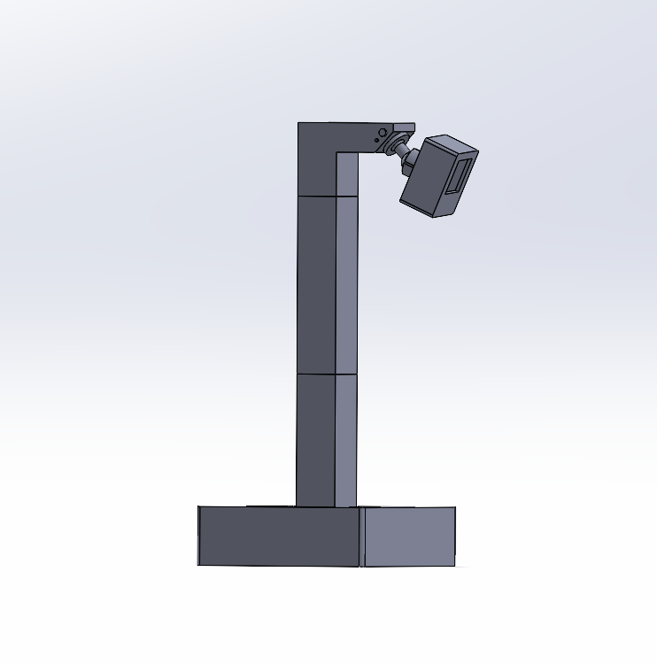
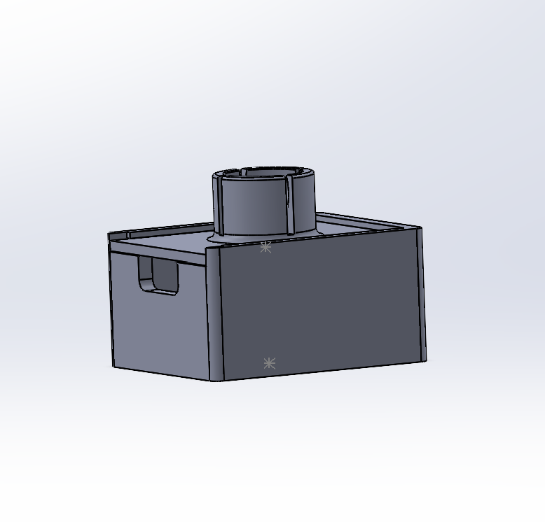

# CAD – ESP32-CAM camera mount

3D-printed mount that holds the ESP32-CAM (+ ESP32-CAM-MB) about 28–30 cm above the
work area, looking down and forward at the table / conveyor. The camera case hangs from a
ball joint, so its angle can be adjusted by hand. Designed in SolidWorks, printed in PLA on a
Bambu Lab H2D.

## Quick View

  
  

## Folder structure

| Folder | Content |
|---|---|
| `SLD_e_SLDASM/` | SolidWorks parts (`.SLDPRT`), assemblies (`.SLDASM`) and the shared variables files |
| `STL/` | Exported meshes, some files might need to be reoriented for printing* (see below) |

> Do not move or rename the SolidWorks files in the file explorer: the assemblies and the
> equations link use their paths. Use *SOLIDWORKS Rename*, *Save As* + *Replace Components*,
> or *Pack and Go* instead.

## Parts

| Part | File | Qty | Role |
|---|---|---|---|
| Tray | `tray_v2.0` | 1 | Holds the boards; lens window in the floor; grooves for the sliding lid |
| Lid + ball socket | `lid_socket_v4.0` / `lid_socket_v4.1` | 1 | Sliding lid with a 4-finger snap socket for the Ø16 ball (v4.1 = without the side hole; both being tested) |
| Plain lid | `lid_v0.1` | 1 | Lid without the socket (spare / alternative) |
| Base block | `base_block_v1.0` | 1 | 130 × 130 × 40 mm block with a square hole for the post |
| Post section | `post_sqr_section_v2.0` | 2 - 3 (dependent on our camera settings) | 30 × 30 mm square section, 120 mm long, stackable (square peg into square hole) |
| Head | `head_v0.1` | 1 | Top of the post; 45° face facing down-forward |
| Ball mount | `ball_mount_v2.3` | 1 | Ø16 ball on a Ø8 neck and a square peg; the peg is a tight press fit in the head |
| Pin | `pin_v1.0` | – | **Not used** (see below) |

| Assembly | Content |
|---|---|
| `camera_unit_v3.0` | tray + lid_socket |
| `stand_v1.1` | base + 2 posts + head + ball mount (+ pin, not used in the printed version) |
| `camera_mount_v1.1` | everything |

## Shared variables

All main dimensions are global variables in `SLD_e_SLDASM/equations.txt`, linked to the
parts (*Tools → Equations → Link to external file*).

- To change a size, edit **only the txt file**, then rebuild the part (Ctrl+Q).
- A **new** variable added to the txt file is not picked up automatically: import it once
  (*Tools → Equations → Import*, tick *Link to file*).
- A dimension is driven by a variable only if it shows **Σ** in front of its value.

Board sizes were measured with a caliper

## Ball socket (lid_socket v4)

| Value | Size |
|---|---|
| Ball / neck | Ø16 / Ø8 |
| Cavity | Ø16.2 (0.1 mm gap all around) |
| Top opening | Ø14.8 (0.6 mm lip each side holds the ball) |
| Fingers | 4, 1.6 mm thick, slits 1.5 mm wide, 11.4 mm deep from the top |
| Tilt range | about ±36° before the neck touches the edge |

The fingers bend about 0.6 mm when the ball is pressed in (about 1.3 % strain, below the
~2 % limit of printed PLA). Print this part in PLA or PETG, not carbon-fibre filament
(too brittle for snap fits).

## Printing

- Printer: Bambu, 0.4 mm nozzle, textured PEI plate
- Material: PLA (PETG preferred for lid_socket)
- Wall loops 4, sparse infill 15–20 %; ball_mount and lid_socket 100 % infill

### The STL files are not in print orientation

The STLs are exported in the SolidWorks model orientation, so some parts open on their side
or upside down. In the slicer, turn each part so the face below is on the bed
(Bambu Studio: select the part → **F** *Lay on face* → click that face). The Bambu project
in `print/` already has the correct orientation.

| Part | Face on the bed |
|---|---|
| tray | outside of the floor (opening facing up) |
| lid_socket | bottom of the lid plate (cup facing up) |
| lid (plain) | the flat outer face |
| base_block | bottom (post hole facing up) |
| post_sqr_section | the end with the square hole (stand it up, peg facing up) |
| head | the flat top face (head printed upside down) |
| ball_mount | end of the square peg (ball facing up) |

### Ball mount ↔ head: no pin needed

The ball mount's square peg (11.8 mm) is tight fit in the head's square hole,
so it holds without the pin. If it ever gets loose, we'll use a pin of similar diameter.

### Printed pins: failed

`pin_v1.0` (Ø2 mm shaft, 31 mm long) failed on every print attempt: printed standing, a 2 mm
shaft is too thin and gets ruined. It is not used. 

## Change log

|Part | Change |
|---|---|
| pin_v1.0 | Printed pins failed every time (Ø2 shaft too thin); pin dropped, ball mount is a press fit in the head |
 | lid_socket v3.1 → v4.0 | Ball did not snap in (walls 5–6 mm, closed top ring). Redesigned: 4 fingers 1.6 mm thick, lip 0.6, cup Ø26 → Ø19.4, lug removed |
| lid_socket v4.1 | Same as v4.0 without the side hole (both printed to compare) |
 | camera_unit v3.0, camera_mount v1.1 | Use lid_socket v4; camera_unit v2.3 and camera_mount v1.0 removed |